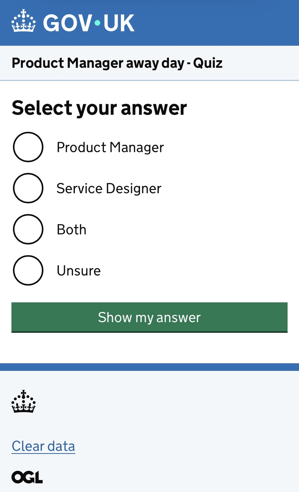
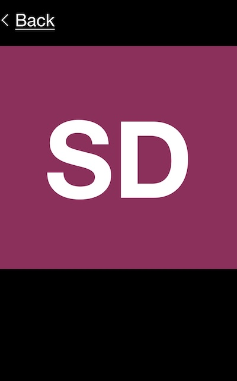
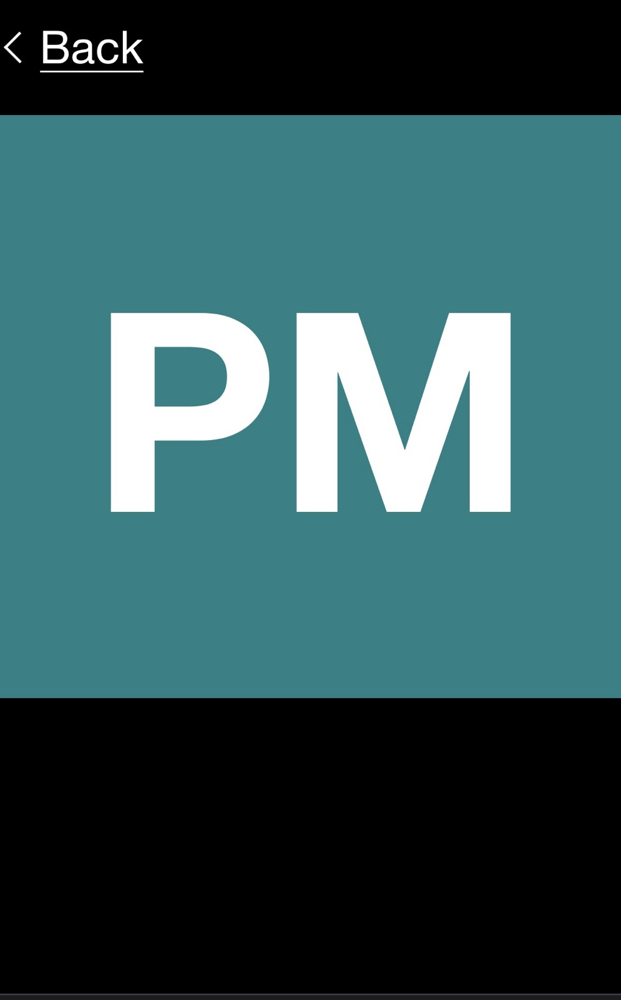

# This is a simple app to support a quiz

# How it's done
The index page allows to select an answer. Each option selected is routed to a view which will show a coloured card on a mobile phone.  
Each view for a card is using a layout I created in: app > views > layouts > **main-card.html** which uses the **unbranded** format for a page. 
  

 

 

## Changing the CSS in unbranded.scss
I've added lines of codes after line 18 in this file **unbranded.scss**
 
To find the file: node_modules > govuk-prototype-kit > lib > assets > sass > unbranded.scss  
This is to have more black space around the colour cards.

## Changing the backlink
I've just changed the colour of the chevron which was grey to white, on line 18 in the file:**_mixin.scss**
 
To find the file: node_modules > govuk-frontend > dist > govuk > components > back-link > _mixin.scss

## Removing the link in the GOV.UK header
As the app will be used on a phone, to avoid people clicking on the link by mistake and finding it hard to find the app again, I've removed the link to GOV.UK.
I've changed line 19 in the **template.njk** file for the header.  
To find the file: node_modules > govuk-frontend > dist > govuk > components > header > template.njk

## Other places to check if you are not used to 'normal prototyping'
You will need to:
- change the name of the service in the **config.json** file
- create some routes in the **route.js**
- add some styling for your cards in the file **applications.scss** which is in assets > sass >

# Information about the GOV.UK prototype kit
This is using the version 14.0.2 of the [GOVUK prototype kit](https://prototype-kit.service.gov.uk/).
